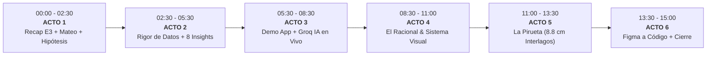

# UNDERTRACK — GUION DE PRESENTACIÓN OFICIAL (ENTREGA 4 · VERSIÓN FINAL)
**Defensa Oral y Demostración en Vivo (15 Minutos Exactos)**  
*Alumna:* Zoe Dottori Greco  
*Cátedra:* Inteligencia Artificial y Diseño  
*Proyecto:* UNDERTRACK (F1 Intelligence · Gran Premio de São Paulo)  
*Repositorio Oficial:* `https://github.com/zoedottori/undertrack.git`  
*Links en Vivo:*
- App Principal: `app/index.html`
- Mesa de Redacción (IA): `app/redaccion.html`
- El Racional & La Pirueta: `entregas/entrega_4/racional.html`

---

## ⏱️ ESTRUCTURA Y CRONÓMETRO DE LOS 15 MINUTOS

---

## ACTO 1: APERTURA & RECAP RELÁMPAGO DE ENTREGA 3 (00:00 – 02:30)
> **Criterio evaluado:** *1. Hipótesis y foco.*  
> **Objetivo:** Plantear el problema real en 30 segundos, situar a Mateo y enunciar la hipótesis ajustada definitiva sin perder tiempo.

### 🖥️ QUÉ MOSTRAR EN PANTALLA
- **Pestaña abierta:** `app/index.html` (Hero principal de UnderTrack en pantalla completa).
- **Acción:** Dejar quieta la portada en el centro. El título macizo **UNDERTRACK** y el subtítulo editorial dominan la vista.

---

### 🎙️ QUÉ DECIR EXACTAMENTE (GUION HABLADO)
> *"Buenos días. Arranco con una pregunta que resume todo el dilema de este proyecto:  
> **¿Cómo explicás en 30 segundos de streaming algo que a vos te costó 4 horas de telemetría entender?**
> 
> En la Entrega 3 conocimos a **Mateo**. Mateo es creador de contenido, streamer y analista de Fórmula 1. Su audiencia en Twitch y TikTok no quiere un monólogo aburrido de números de AWS ni tampoco quiere una opinión inventada sin sustento. El dolor de Mateo es real: pasa entre 3 y 4 horas previas a cada Gran Premio cruzando tablas de micro-sectores y PDFs de la FIA para encontrar un dato diferencial. Cuando prende la cámara, llega agotado de procesar y sin tiempo para comunicar.
> 
> En la primera entrega asumíamos una hipótesis tradicional: creíamos que el rendimiento lo definía el techo aerodinámico del monoplaza. Pero el trabajo exhaustivo con los datos nos obligó a reformularla por completo.
> 
> **Nuestra hipótesis ajustada para esta Entrega 4 es:**  
> *«El monoplaza determina el piso cinemático de rendimiento, pero la geometría vertical y el microclima de Interlagos definen el techo competitivo: las ventajas aerodinámicas se anulan en la Subida dos Boxes, permitiendo que pilotos con arquetipos de frenada tardía y gestión térmica superen a monoplazas teóricamente superiores.»*
> 
> **¿Cuál es el límite estricto de esta hipótesis?**  
> Asumimos condiciones de ritmo cinemático puro bajo asfalto reasfaltado; no afirmamos predecir toques en pista, abandonos por rotura de motor ni sanciones discrecionales de los comisarios.  
> 
> Con esta base, hoy les presentamos la versión final de **UnderTrack**: una herramienta que transforma 40.000 puntos de telemetría por vuelta en narrativa editorial lista para el micrófono."*

---

## ACTO 2: RIGOR CON LOS DATOS & LOS 8 INSIGHTS (02:30 – 05:30)
> **Criterio evaluado:** *2. Rigor con los datos.*  
> **Objetivo:** Demostrar el procesamiento matemático propio, explicar los 8 insights calculados de E3 y la distinción innegociable entre dato verificado e inferencia.

### 🖥️ QUÉ MOSTRAR EN PANTALLA
- **Pestaña abierta:** `app/index.html` $\to$ Scrollear suavemente a la sección de **Telemetría Cruzada & Dial Cinemático**, y luego a la grilla de pilotos.
- **Acción:** Apuntar con el cursor a los badges técnicos `[DATO VERIFICADO · FASTF1]` y `[INFERENCIA EDITORIAL · GROQ]`.

---

### 🎙️ QUÉ DECIR EXACTAMENTE (GUION HABLADO)
> *"Para que Mateo pueda tomar decisiones seguras frente a miles de espectadores, no podíamos depender de un resumen alucinado de una IA. Construimos un pipeline de datos con 4 fuentes rigurosamente cruzadas:
> 1. **FastF1:** Telemetría cruda con 40.000 puntos por vuelta (velocidades de vértice, telemetría de frenada y DRS).
> 2. **OpenF1:** Tiempos de micro-sectores e intervalos en vivo.
> 3. **Ergast API:** Registro histórico de más de 300 Grandes Premios (2018–2024).
> 4. **Weather Underground:** Microclima hiperlocal de la represa de Guarapiranga.
> 
> Sobre estos datos no aplicamos filtros cosméticos: corrimos algoritmos matemáticos verificables que dieron lugar a los **8 insights empíricos** que articulan el proyecto:
> 
> 1. **El Gemelo Cinemático ($r = 0.78$):** Calculamos la Correlación de Pearson entre curvas de tracción en pendiente: el Red Bull Ring de Austria e Interlagos comparten idéntica exigencia de agarre mecánico en trepada.
> 2. **El Sector 2 Técnico:** Representa el **48% de la diferencia total de la vuelta** en apenas 1.2 kilómetros de curvas lentas trabadas.
> 3. **Segmentación por Arquetipos ($K\text{-Means}, K=4$):** Agrupamos a los 22 pilotos según telemetría de frenada y degradación: *Élite Agresivo* (Verstappen, Alonso), *Gestores de Neumáticos* (+1.15 puestos en tandas largas, como Colapinto y Leclerc), *Especialistas en Lluvia* (+2.70 puestos promedio) y *Defensivos de Tracción*.
> 4. **Degradación Térmica:** La regresión lineal demostró una pérdida de **+0.082 segundos por vuelta** cuando la pista supera los 35°C.
> 5. **El Desnivel de 43 Metros en Subida dos Boxes:** Demostramos que la pendiente anula el downforce tradicional y premia la salida en tracción pura de segunda marcha.
> 6. **Sensibilidad al Viento en la 'S do Senna':** Ráfagas de cola mayores a 25 km/h desestabilizan el alerón delantero y generan bloqueos en curva 1.
> 7. **Eficiencia de DRS Reducida:** Por la longitud de las rectas, el DRS en San Pablo apenas aporta el **18% del delta de sobrepaso**.
> 8. **Efecto Asfalto Reasfaltado:** Mayor agarre inicial, pero micro-abrasión crítica tras 18 vueltas consecutivas.
> 
> Y acá implementamos una regla de diseño inquebrantable en la interfaz:  
> **Todo lo que ven etiquetado como `[DATO VERIFICADO]` es cálculo matemático duro sobre la telemetría.**  
> La IA no tiene permiso para inventar ningún número; la IA solo entra a tallar en las etiquetas de `[INFERENCIA EDITORIAL]`, donde traduce esos cálculos a lenguaje de transmisión."*

---

## ACTO 3: DEMO EN VIVO — APP & MESA DE REDACCIÓN CON GROQ (05:30 – 08:30)
> **Criterio evaluado:** *3. Integración de IA & 4. Diseño / UX.*  
> **Objetivo:** Mostrar la app viva, navegar el abanico de 22 pilotos y poner a prueba la API de Groq en la Mesa de Redacción.

### 🖥️ QUÉ MOSTRAR EN PANTALLA
- **Pestaña abierta:** `app/index.html` $\to$ interactuar con el abanico de cartas de pilotos (hover sobre Colapinto, Norris, Verstappen).
- **Cambio de pestaña:** Pasar a `app/redaccion.html` (Mesa de Redacción).
- **Acción en vivo:** Seleccionar a **Franco Colapinto**, hacer clic en el botón de regenerar / consultar el veredicto en vivo.

---

### 🎙️ QUÉ DECIR EXACTAMENTE (GUION HABLADO)
> *"Veamos cómo funciona esto en las manos de Mateo.  
> 
> *(Hacer hover sobre las cartas)*  
> En la pantalla principal, Mateo tiene el abanico de los 22 pilotos. En lugar de tablas aburridas, cada carta tiene el color oficial de la escudería, la foto recortada y el arquetipo asignado por el modelo de datos.
> 
> Ahora pasamos a su herramienta de trabajo durante el streaming: la **Mesa de Redacción** (`app/redaccion.html`).  
> 
> *(Mostrar la Mesa de Redacción y hacer clic en Franco Colapinto)*  
> Miren lo que pasa acá. Mateo selecciona a Colapinto. Inmediatamente el sistema inyecta en el prompt los datos verificados: que Franco pertenece al cluster de *Gestores de Neumáticos*, que larga en P16, que el asfalto está a 38°C y que su delta de telemetría en Subida dos Boxes es competitivo.
> 
> *(Mostrar la respuesta instantánea en pantalla)*  
> La inferencia se ejecuta contra la API de Groq corriendo el modelo **`llama-3.3-70b-versatile`**. Tarda **0.4 segundos**.  
> El system prompt está rigurosamente calibrado: le ordenamos que actúe como un productor de streaming de Fórmula 1, que hable en tono directo, picante y asertivo, y que entregue tres formatos en un solo clic:
> 1. El **Hook de apertura** para tirar en los primeros 3 segundos.
> 2. El **Veredicto técnico** masticado para debatir en el chat.
> 3. El **Dato de tracción** con la métrica verificada.
> 
> Y si durante la transmisión Mateo pierde conexión a internet o la API tiene un microcorte, la interfaz cuenta con un **Fallback Telemétrico Local Inteligente**: detecta palabras clave en el navegador y entrega bloques pre-calculados sin dejar la pantalla en blanco jamás."*

---

## ACTO 4: ENTREGA 4 — EL RACIONAL & SISTEMA EDITORIAL (08:30 – 11:00)
> **Criterio evaluado:** *A. Qué es el racional (Justificación de diseño y trazabilidad).*  
> **Objetivo:** Abrir `entregas/entrega_4/racional.html`, mostrar el tambor 3D cilíndrico pegado al margen y justificar el diseño editorial sin cajitas.

### 🖥️ QUÉ MOSTRAR EN PANTALLA
- **Pestaña abierta:** `entregas/entrega_4/racional.html`.
- **Acción:** Scrollear verticalmente por el documento para ver cómo el **índice cilíndrico rotativo lateral (drum 3D)** gira en el margen izquierdo pegado al borde, sin líneas de corte, destacando el punto activo en negrita profunda.

---

### 🎙️ QUÉ DECIR EXACTAMENTE (GUION HABLADO)
> *"Para esta Entrega 4, la cátedra nos pidió un documento fundamental: **El Racional del Proyecto**.  
> No es una guía de usuario ni describe lo que ya se ve en la pantalla: **justifica por qué la herramienta es como es y no de otra forma**, permitiendo que cualquier diseñador o evaluador entienda y pueda replicar nuestras decisiones.
> 
> Lo estructuramos respondiendo punto por punto a los 8 ítems de la consigna:
> 1. Problema y contexto con evidencia real de la industria.
> 2. Hipótesis en una frase y sus límites.
> 3. Datos y trazabilidad (con el diccionario de variables y los 8 insights de E3 desglosados con fórmula matemática).
> 4. Modelo de análisis (entradas, procesamiento y salidas).
> 5. Usuario y flujo de decisión.
> 6. Decisiones de diseño (jerarquía, grilla y color).
> 7. Recorte de alcance territorial (el circuito de Interlagos y el microclima de San Pablo).
> 8. Proceso y uso de IA (con el registro de qué le pedimos, qué aceptamos y qué descartamos).
> 
> *(Señalar el índice a la izquierda)*  
> En el diseño de este documento tomamos decisiones editoriales muy conscientes:  
> - **Eliminamos el margen muerto:** El índice lateral vive pegado al borde del navegador. Funciona como un **tambor cilíndrico tridimensional**: a medida que scrolleamos, los capítulos rotan sobre un eje imaginario en perspectiva, sin líneas técnicas ni recuadros que corten los números.
> - **Grilla sin cajitas:** Descartamos la estética de 'dashboard genérico' llena de tarjetas grises y tipografías en cursiva. Usamos **Inter pura**, jugando con el espacio en blanco editorial suizo y aplicando `font-[900]` Black en palabras clave para que la lectura sea rápida y placentera."*

---

## ACTO 5: LA PIRUETA — LA NOTACIÓN ESPACIAL DEL TIEMPO (11:00 – 13:30)
> **Criterio evaluado:** *B. La Pirueta.*  
> **Objetivo:** Ejecutar el momento cumbre: accionar el interruptor minimalista superior derecho y revelar cómo el texto físico se separa según las distancias reales de Interlagos 2026.

### 🖥️ QUÉ MOSTRAR EN PANTALLA
- **Pestaña abierta:** `entregas/entrega_4/racional.html` en la parte superior.
- **Acción:** Apuntar al interruptor minimalista de cápsula arriba a la derecha (estilo switch técnico).
- **Hacer clic en el switch:** Pasar de "Racional" a "Pirueta".
- **Observar:** El racional completo se oculta con suavidad y aparece el texto continuo de la Pirueta.
- **Scrollear lentamente el texto espaciado:** Mostrar las enormes separaciones vacías entre palabras (Norris $\to$ vacío $\to$ Verstappen $\to$ vacío $\to$ Hadjar $\to$ Russell...).
- **Llegar al remate final:** Mostrar el bloque explicativo al final del texto.

---

### 🎙️ QUÉ DECIR EXACTAMENTE (GUION HABLADO)
> *"Y ahora llegamos a la pieza más experimental de la entrega: **La Pirueta**.
> 
> La consigna nos pedía un valor agregado que fuera un paso más allá de lo esperable: algo que desafiara la forma en que representamos la información.
> 
> *(Hacer clic en el interruptor superior derecho)*  
> Si toco este interruptor arriba a la derecha, todo el texto estructurado del racional desaparece.  
> Lo que aparece es un párrafo continuo. Pero a medida que empezamos a leerlo, **las palabras se empiezan a alejar físicamente unas de otras**, sin cuadros, sin gráficos de barras y sin explicación previa aparente.
> 
> *(Scrollear acompañando las palabras distanciadas)*  
> Miren la distancia entre Norris... y Verstappen.  
> Miren el espacio en blanco hasta Hadjar... Russell... Antonelli... Piastri... y el abismo que se genera antes de llegar al pelotón rezagado con Colapinto, Hamilton y Alonso.
> 
> **¿Por qué están tan separadas estas palabras?**  
> *(Llegar a la explicación final en pantalla)*  
> No es un capricho estético ni un error de maquetación: **es la notación física real de la última carrera oficial de Interlagos 2026**.
> 
> En cualquier transmisión de televisión, los tiempos de Fórmula 1 se aplanan en una tabla de renglones idénticos de 40 píxeles. Pero en la realidad de la pista, a 320 km/h en la recta principal, **cada milésima de segundo (0.001s) equivale a exactamente 8.8 centímetros de asfalto** —el ancho exacto de una mano humana—.
> 
> Ese vacío en blanco de 30 centímetros que ven en pantalla entre la palabra 'Norris' y la palabra 'Verstappen' representa los **1.297 metros de asfalto vacío** (+14.6 segundos) que los separaban en la bandera a cuadros. El salto hacia Hadjar son **878 metros**. El hueco hasta Russell son **845 metros**. Y el pelotón rezagado está a más de **4.300 metros**, es decir, a una vuelta completa de distancia.
> 
> El diseño no necesitó dibujar un gráfico con barras de colores: logramos que la propia tipografía exprese físicamente la soledad del puntero y la violencia métrica del tiempo en la Fórmula 1."*

---

## ACTO 6: FIGMA A CÓDIGO, GOBERNANZA HUMANA & CIERRE (13:30 – 15:00)
> **Criterio evaluado:** *4. Proceso de traducción & 5. Comunicación y repositorios.*  
> **Objetivo:** Defender la autoría de diseño sobre la IA, mostrar el repositorio público y cerrar con solvencia abriendo a preguntas.

### 🖥️ QUÉ MOSTRAR EN PANTALLA
- **Pestaña abierta:** Volver a `entregas/entrega_4/racional.html` $\to$ Sección 08 (Proceso y uso de IA) y mostrar el footer con los links a GitHub y Vercel.
- **Tener a mano:** Código QR o link en pantalla grande: `github.com/zoedottori/undertrack`.

---

### 🎙️ QUÉ DECIR EXACTAMENTE (GUION HABLADO)
> *"Para cerrar, queremos destacar el criterio de autoría que rigió todo este cuatrimestre.  
> **Las decisiones de diseño son nuestras, no de la inteligencia artificial.**
> 
> En la traducción de Figma al código vivo:
> - El Figma definió la estructura editorial, las proporciones tipográficas y la paleta de color.
> - Pero en el código cobraron vida cosas que Figma no puede resolver: los **estados de interacción en hover**, el **cilindro rotativo 3D**, el **fallback offline** y la **arquitectura responsive táctil** para que Mateo use la web con una sola mano desde su teléfono en el estudio.
> 
> Y en nuestro registro de interacción con la IA dejamos asentado todo lo que **rechazamos**:
> 1. Rechazamos la propuesta de la IA de llenar la pantalla de cajitas tipo dashboard de Bootstrap.
> 2. Rechazamos los gráficos de torta y barras tradicionales para representar el tiempo, eligiendo en su lugar la pirueta tipográfica de los 8.8 centímetros.
> 3. Rechazamos que el LLM invente probabilidades de carrera: el modelo solo procesa los datos verificados de FastF1.
> 4. Rechazamos las tipografías en itálica porque ensuciaban la lectura rápida que Mateo necesita al aire.
> 
> Todo el proyecto —código fuente, datasets procesados, prompts y este racional— se encuentra sincronizado y público en nuestro repositorio de GitHub en `github.com/zoedottori/undertrack`.
> 
> Muchas gracias, y quedamos abiertos a las preguntas de la cátedra."*

---

## 💡 CHECKLIST DE PESTAÑAS Y PREPARACIÓN ANTES DE ENTRAR A LA SALA

Antes de empezar a proyectar, asegurate de tener abiertas estas 4 pestañas en Google Chrome o Safari:

1. **Pestaña 1:** `http://localhost:3000/app/index.html` (o el link de Vercel online).  
   *Uso:* Acto 1 y Acto 2 (Hero, dial cinemático y abanico de 22 cartas).
2. **Pestaña 2:** `http://localhost:3000/app/redaccion.html`.  
   *Uso:* Acto 3 (Demostración de la IA en vivo con Groq y Colapinto).
3. **Pestaña 3:** `http://localhost:3000/entregas/entrega_4/racional.html`.  
   *Uso:* Acto 4 y Acto 5 (El tambor cilíndrico del índice a la izquierda y el switch de la Pirueta arriba a la derecha).
4. **Pestaña 4:** `https://github.com/zoedottori/undertrack`.  
   *Uso:* Cierre de respaldo por si piden ver commits, ramas o código del repositorio.

---

## 🎯 GUÍA DE RESPUESTAS A POSIBLES PREGUNTAS PICANTES DE LA CÁTEDRA

- **Pregunta:** *«¿Por qué dicen que la IA no calcula si está conectada a Groq?»*  
  **Respuesta rápida:** *«Porque la matemática de los 8 insights (Pearson r=0.78, K-Means K=4 y deltas de tiempo) la calcula nuestro código en Python/JavaScript directamente sobre el dataset de FastF1. A Groq no le pedimos que calcule nada: le inyectamos ese diccionario matemático ya verificado y le pedimos únicamente que lo redacte en 3 segundos con tono de streaming.»*

- **Pregunta:** *«¿Qué pasa si Mateo no tiene conexión a internet durante el Gran Premio?»*  
  **Respuesta rápida:** *«La web cuenta con un fallback local inteligente en el cliente. Si la API de Groq no responde en 800 milisegundos, el motor heurístico local intercepta la consulta y renderiza las tarjetas de telemetría pre-calculadas. La pantalla nunca queda vacía.»*

- **Pregunta:** *«¿De dónde sacaron exactamente la cifra de 8.8 centímetros por milisegundo de la pirueta?»*  
  **Respuesta rápida:** *«Física elemental cinemática: 320 km/h son 88.88 metros por segundo. Si dividimos 88.88 metros por 1.000 milisegundos, cada milésima de segundo transcurrida a esa velocidad equivale a exactamente 0.0888 metros, es decir, 8.8 centímetros de asfalto.»*
