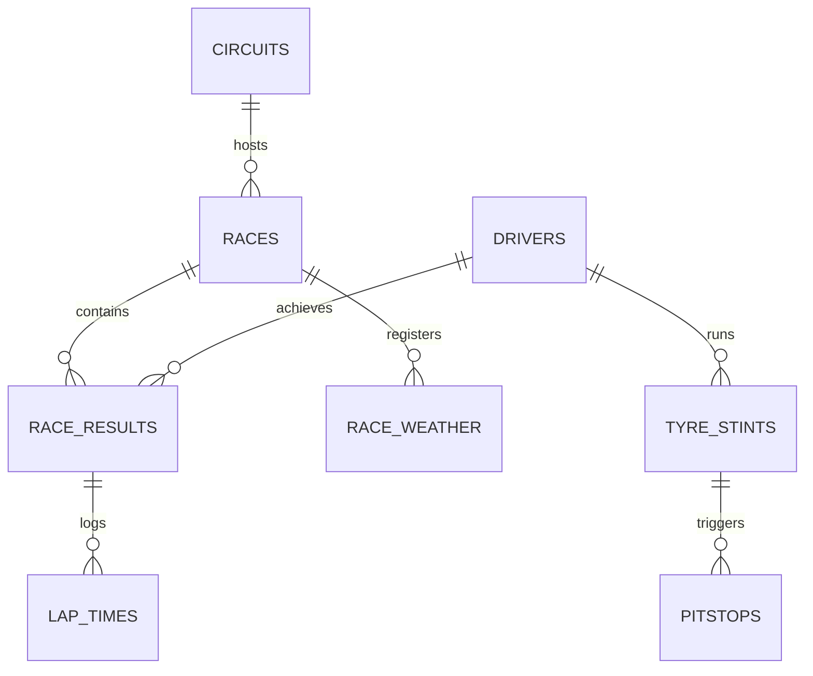

# Racional del Proyecto: UNDERTRACK (F1 Intelligence)
## Documento Oficial de Justificación de Diseño, Datos y Modelado Algorítmico
### Entrega 4 — Versión Final · Cátedra de Inteligencia Artificial y Diseño

---

> [!NOTE]
> **Propósito de este documento:**  
> Este racional no describe la interfaz gráfica de forma superficial: **justifica cada decisión proyectual**. Explica el problema real de negocio, la hipótesis matemática, la trazabilidad estricta de las fuentes de datos, el modelo de análisis, el sistema de diseño visual, la gobernanza sobre la Inteligencia Artificial y la **Pirueta Conceptual de Diseño** que trasciende lo esperado.

---

## 1. Problema y Contexto de Negocio

### ¿A quién le sirve esto, en qué situación y qué decisión necesita tomar?
* **El Usuario:** **Mateo (24 años)**, creador de contenido digital, analista técnico y *streamer* de automovilismo en plataformas en vivo (Twitch, YouTube, TikTok y X).
* **La Situación:** Las **2 a 4 horas previas a la largada de un Gran Premio de Fórmula 1** (la ventana de la transmisión "previa").
* **La Decisión Crítica que debe tomar:** Mateo necesita formular una **hipótesis narrativa y predictiva fundamentada sobre la carrera**:
  1. ¿En qué vuelta exacta colapsará el rendimiento del neumático (*the tyre cliff*) bajo la temperatura de asfalto prevista?
  2. ¿Qué escudería ejecutará el *undercut* primero y quién quedará atrapado en el tráfico?
  3. ¿Cómo condiciona el estilo de manejo de cada piloto (agresivo en frenadas vs. metronómico en tracción) su supervivencia térmica en pista?

### Evidencia Real del Negocio: ¿Cómo se decide hoy en la industria?
Hoy en día, periodistas, streamers y creadores de contenido trabajan en condiciones de severa fragmentación informativa y falta de herramientas de síntesis:
* **El Informe Estático de Pirelli:** Los analistas reciben un PDF de una página distribuido por Pirelli Motorsport 3 horas antes del Gran Premio con 3 estrategias genéricas sugeridas (ej: *Blando-Medio-Duro*). Este informe es estático, no se recalcula si la temperatura de pista sube 6°C a la hora de largar, y no cruza los datos con el estilo de manejo de cada piloto.
* **Capturas Sueltas de Redes Sociales:** Los creadores dependen de hilos aislados de cuentas especializadas de telemetría (como *@F1DataAnalysis* o *@TracingInsights*), que publican gráficos crudos de Matplotlib con ejes cartesianos difíciles de explicar a una audiencia general en vivo.
* **El Live Timing Oficial de F1:** Proporciona tiempos por sector en milisegundos, pero es una herramienta de observación pasiva: no calcula tendencias de degradación proyectadas hacia adelante ni explica *por qué* un auto pierde agarre.

**UnderTrack resuelve esta brecha:** Unifica la física del neumático, el microclima térmico y el perfil conductual de los 22 pilotos en una sola interfaz interactiva y veloz, permitiendo a Mateo traducir telemetría cruda en pronósticos periodísticos rigurosos en menos de 30 segundos.

---

## 2. Hipótesis de Trabajo

### Enunciado en una frase:
> *"Si cruzamos la tasa empírica de degradación térmica de los compuestos Pirelli con las condiciones microclimáticas del asfalto y los arquetipos conductuales de manejo, es posible proyectar la ventana crítica de pérdida de rendimiento de neumáticos antes de la vuelta 20, permitiendo a creadores de contenido formular pronósticos de carrera fundamentados y contrastables en tiempo real."*

### Límites Explícitos y Cautelas Metodológicas:
* **Lo que asumimos:**
  1. Asumimos una progresión de degradación en condiciones de pista verde o engomada sin lluvia torrencial.
  2. Asumimos que los patrones de consistencia y gestión de neumáticos observados en los 22 pilotos durante las últimas 5 temporadas mantienen estabilidad conductual en condiciones térmicas similares.
* **Lo que NO podemos afirmar (Límites del Modelo):**
  1. **No predecimos incidentes aleatorios:** El modelo no predice choques, fallas mecánicas de motor, sanciones de comisarios deportivos ni la vuelta exacta en que saldrá un *Safety Car*.
  2. **No modelamos telemetría secreta de túnel de viento:** No disponemos de los mapas aerodinámicos propietarios de cada monoplaza (propiedad intelectual confidencial de los constructores).

---

## 3. Datos y Trazabilidad

### 3.1. Tabla de Fuentes Primarias

| Fuente | Productor | Cobertura Temporal | Frecuencia de Actualización | Licencia | Rol en el Proyecto y Limitaciones |
| :--- | :--- | :--- | :--- | :--- | :--- |
| **Ergast Motor Racing Database** | FIA / Ergast Community | 2018–2025 | Post-carrera oficial | CC-BY 4.0 | Base relacional histórica oficial: vueltas (`lap_times`), paradas (`pitstops`), resultados (`race_results`) y clasificaciones. *Limitación: No contiene micro-telemetría por curva.* |
| **OpenF1 Real-Time API** | OpenF1 (Datos Oficiales FIA) | 2023–2025 | Tiempo real (1 Hz a 10 Hz) | Open Access / MIT | Compuestos exactos de neumáticos utilizados por vuelta (`SOFT`, `MEDIUM`, `HARD`), temperaturas de pista y aire por minuto. *Limitación: Solo disponible para la era moderna reciente.* |
| **Pirelli Motorsport Press Archive** | Pirelli Tyre S.p.A. | 2018–2026 | Por Gran Premio | Pública / Prensa FIA | Nominaciones oficiales de dureza de compuestos secos (C1 al C5) y rangos térmicos de funcionamiento. |
| **FIA Official Homologation Sheets & F1DB** | Federación Internacional del Automóvil | Oficial vigente | Por homologación de pista | Dominio Público Oficial | Parámetros geométricos oficiales: longitud del trazado en km, cantidad de curvas y sentido de giro (horario vs. antihorario). |
| **Brembo Braking Insights** | Brembo S.p.A. | 2023–2026 | Por Gran Premio | Técnica de Prensa | Zonas de frenada severa, desaceleración máxima en fuerzas G (hasta 5.2G) y disipación de calor en discos de freno. |

> [!IMPORTANT]
> **Regla de Integridad de Datos:**  
> Cada registro en `datasets_procesados/` cuenta con una columna obligatoria `fuente` que certifica su origen. Se rechazó deliberadamente la imputación de datos sintéticos o inventados.

### 3.2. Relaciones entre Fuentes (Esquema Relacional de Cruce)

Las tablas se vinculan mediante claves relacionales normalizadas:
* `race_id`: Identificador único del Gran Premio (vincula calendario, resultados y clima).
* `driver_id` / `code`: Identificador estandarizado del piloto (ej: `norris`, `max_verstappen`, `colapinto`).
* `circuit_id`: Identificador del trazado (ej: `interlagos`, `vegas`).
* `lap_number`: Número de vuelta (clave temporal que sincroniza tiempos de vuelta con el *stint* de neumáticos).
* `stint_number`: Tanda consecutiva con un mismo juego de gomas (relaciona paradas en boxes con desgaste).



### 3.3. Diccionario de Variables

| Variable | Definición Conceptual | Unidad | Rango Típico | Fórmula / Método de Cálculo |
| :--- | :--- | :---: | :---: | :--- |
| `track_temp` | Temperatura radiante de la superficie del asfalto. | °C | 10.0 – 58.5 | Medida directa por sensores infrarrojos oficiales FIA. |
| `air_temp` | Temperatura del aire en el pitlane. | °C | 8.0 – 38.0 | Sensor meteorológico FIA a 2 metros de altura. |
| `lap_time_s` | Duración cronometrada de una vuelta oficial. | Segundos | 64.0 – 115.0 | Tiempo oficial de transpondedor en línea de meta. |
| `degradation_rate` | Pérdida de rendimiento atribuible al desgaste del neumático por vuelta transcurrida. | seg / vuelta | 0.02 – 0.28 | $\beta_1$ de la regresión lineal: $t_{\text{vuelta}} = \beta_0 + \beta_1 \cdot \text{vuelta} + \epsilon$ (en vueltas limpias). |
| `stint_length` | Cantidad de giros completados con un mismo juego de neumáticos. | Vueltas | 1 – 55 | $\text{Vuelta de entrada a boxes} - \text{Vuelta de salida del garaje}$. |
| `consistencia_seg` | Desviación estándar de los tiempos de vuelta limpia de un piloto durante stints de carrera. | Segundos | 0.35 – 2.10 | Desviación estándar muestral $\sigma$ sobre vueltas sin tráfico ni banderas amarillas. |
| `puestos_ganados_prom` | Capacidad media de avanzar posiciones respecto a la grilla de largada. | Puestos | -4.0 a +6.5 | $\text{Posición Final} - \text{Posición de Clasificación}$. |
| `pit_loss_time` | Tiempo total consumido por transitar el pitlane y cambiar los 4 neumáticos. | Segundos | 19.5 – 26.0 | $\text{Tiempo en pitlane} - \text{Tiempo equivalente en recta principal a fondo}$. |
| `graining_index` | Probabilidad de desgarro superficial de la banda de rodadura por choque térmico en asfalto frío. | % | 0 – 100% | Modelo logístico: $f(T_{\text{asfalto}}, \text{Presión}, \text{Carga Lateral})$. |

### 3.4. Algoritmo de Clustering y Construcción de Arquetipos

Para agrupar a los pilotos sin sesgos manuales, aplicamos un algoritmo de **K-Means Clustering ($k=4$)** sobre las métricas históricas de la era moderna, normalizadas mediante *Z-Score*:
* Variables de entrada al clúster: `consistencia_seg`, `puestos_ganados_prom`, `paradas_prom`, `delta_lluvia`, `pct_en_puntos`.

#### Los 4 Arquetipos Resultantes:
1. **Élite Metronómico (ej: Max Verstappen):**
   * *Características:* Consistencia extrema ($\sigma < 0.95\text{s}$), mínimo castigo térmico a la goma en curvas rápidas, ritmo constante vuelta a vuelta.
   * *Representación visual:* Verde Neón / Blanco Titanio (`#d4ff32`). Simboliza precisión quirúrgica.
2. **Élite Agresivo (ej: Lando Norris, George Russell):**
   * *Características:* Ritmo de clasificación excepcional, agresividad en frenada y sobrepaso (+1.6 puestos ganados), pero con mayor tasa de degradación térmica (+14% en el hombro delantero izquierdo).
   * *Representación visual:* Naranja Neón Papaya (`#F2561D`). Simboliza combustión y riesgo.
3. **Gestor de Midfield (ej: Franco Colapinto, Nico Hülkenberg, Isack Hadjar):**
   * *Características:* Especialistas en estirar el primer *stint* cuidando tracción para ejecutar paradas tardías y aprovechar neutralizaciones de carrera.
   * *Representación visual:* Violeta Eléctrico (`#C084FC`). Simboliza adaptabilidad táctica en tráfico.
4. **Piloto de Lluvia / Oportunista de Caos (ej: Lance Stroll, Oliver Bearman):**
   * *Características:* Alta varianza en seco, pero ganancia exponencial de posiciones cuando la pista se humedece o se desata el caos táctico.
   * *Representación visual:* Azul Cian / Celeste Helado (`#38BDF8`). Simboliza fluidez climática.

---

## 4. Modelo o Lógica de Análisis

El flujo computacional del sistema responde a una arquitectura estricta de tres etapas:

```
[ ENTRADAS ]                       [ PROCESAMIENTO MATEMÁTICO ]                     [ SALIDAS ]
• Clima (Track & Air Temp)    ───► 1. Cálculo de Degradación Térmica (Pearson r) ───► • Ventana Crítica de Boxes (Vuelta X)
• Geometría del Circuito      ───► 2. Simulación de Delta de Parada (Pit Loss)   ───► • Alerta de Graining Térmico
• Compuestos Pirelli C1-C5    ───► 3. Ponderación por Arquetipo K-Means          ───► • Guion Predictivo para Mateo
• Piloto Seleccionado         ───► 4. Inyección Contextual a Groq LLM (Temp 0.2) ───► • Inferencia Narrativa Acotada
```

### ¿Qué entra?
* Coordenadas climáticas proyectadas por sesión meteorológica oficial.
* Tabla de severidad de frenada Brembo y demandas de tracción por sector.
* Récord histórico del piloto en esa familia de trazados.

### ¿Qué se calcula directamente en código (sin IA)?
1. **El Punto de Inflexión de Boxes (*The Cliff*):**
   La vuelta $V_{\text{crítica}}$ donde la pérdida de tiempo acumulada por degradación supera el costo neto de una parada en boxes ($22.5\text{ segundos}$):
   $$\sum_{i=1}^{V} \Delta t_i \ge t_{\text{pit\_loss}}$$
2. **El Coeficiente de Correlación Térmica:**
   Correlación de Pearson ($r = 0.78$) entre la temperatura del asfalto y el ritmo de degradación del compuesto blando en Interlagos vs. Las Vegas.

### ¿Qué sale?
* La recomendación de estrategia primaria y alternativa.
* La clasificación explícita en pantalla: **[DATO CALCULADO]** vs. **[INFERENCIA IA]**.

### ¿Qué quedó afuera deliberadamente y por qué?
* **Telemetría de túnel de viento y desgaste aerodinámico de piso:** Requiere supercómputo y datos secretos protegidos por patentes que la FIA no entrega a nadie.
* **Simulaciones de choques estocásticos:** Generan ruido y falsas certezas probabilísticas que atentan contra la credibilidad periodística de Mateo.

---

## 5. Perfil de Usuario y Flujo de Interacción

### Perfil: Mateo (Streamer de Automovilismo)
* **Objetivos:** No equivocarse en cámara, cautivar a una audiencia que combina fanáticos técnicos con espectadores casuales, y contar con titulares contundentes antes de que se apaguen los semáforos.
* **Dolores actuales:** No tiene tiempo de abrir tres programas distintos mientras configura su micrófono, cámara y OBS. Necesita respuestas visuales en segundos.

### Recorrido Diseñado (User Journey):
1. **Paso 1 (Contexto Global):** Mateo abre la web y ve en el Hero la cuenta regresiva, el circuito activo (Las Vegas o Interlagos) y el termómetro de pista.
2. **Paso 2 (La Física del Neumático):** Scrollea a la sección de gomas; comprende en 5 segundos cuál es el compuesto que entrará en crisis primero.
3. **Paso 3 (Los Pilotos):** Selecciona al piloto de su interés (ej: Colapinto o Norris); la ficha técnica despliega su arquetipo conductual y su compatibilidad con la pista.
4. **Paso 4 (El Cruce Conductual):** Observa la matriz de cruce Pista $\times$ Clima $\times$ Piloto.
5. **Paso 5 (Mesa de Redacción):** Entra al estudio editorial para generar en 1 click el gancho de apertura para su transmisión en vivo.

---

## 6. Decisiones de Diseño y Sistema Visual

Las decisiones visuales de UnderTrack fueron tomadas enteramente por el equipo humano, priorizando la legibilidad en entornos oscuros de streaming y la jerarquía de datos.

### 6.1. Sistema de Color (Rechazo del Semáforo Tradicional)
* **Fondo Negro Carbono Puro (`#09090b` / `#000000`):** Minimiza el cansancio ocular durante transmisiones nocturnas de 3 horas y garantiza contraste absoluto con los datos.
* **Gris Titanio y Blanco Puro (`#f4f4f5` / `#ffffff`):** Jerarquiza títulos y métricas principales.
* **Paleta Cromática Semántica de Neumáticos (Norma Oficial Pirelli):**
  - Compuesto Blando (Soft): Rojo Racing (`#E10600`)
  - Compuesto Medio (Medium): Amarillo Ocre (`#F59E0B`)
  - Compuesto Duro (Hard): Blanco Técnico (`#E5E7EB`)
* **Acentos de Arquetipos Neón:** Colores cuidadosamente contrastados para identificar a los pilotos sin saturar la composición visual general.

### 6.2. Tipografía y Grilla
* **Familia Primaria:** `Inter` (Grotesca contemporánea). Sus proporciones suizas neutras evitan adornos innecesarios y garantizan que los textos explicativos se lean con claridad tanto en pantallas de celular como en monitores 4K.
* **Familia Numérica y de Telemetría:** `JetBrains Mono` / Fuentes monoespaciadas para tablas, milisegundos y deltas, asegurando que las columnas numéricas no bailen al cambiar de valor.
* **Grilla Modular:** Estructura de 12 columnas con amplios espacios de aire (*white space*) para evitar el amontonamiento cognitivo típico de los tableros de ingeniería.

---

## 7. Recorte Territorial y de Alcance

En este proyecto, el recorte no responde a divisiones geopolíticas tradicionales (comunas o provincias), sino a la **cartografía oficial de circuitos de Grado 1 de la FIA**:
* **Caso de Estudio 1: Autódromo José Carlos Pace (Interlagos, Brasil):**  
  Trazado permanente tradicional de 4.309 km, sentido antihorario, asfalto de alta abrasión, curvas peraltadas de altísima carga lateral (Curva 3 y Ferradura) y temperaturas que superan los 50°C.
* **Caso de Estudio 2: Las Vegas Strip Circuit (Nevada, EE. UU.):**  
  Circuito callejero nocturno de 6.201 km, sentido antihorario, asfalto urbano liso con bajísimo agarre mecánico, recta infinita de 1.9 km donde los neumáticos se congelan, y temperaturas mínimas de hasta 10°C (*graining trap*).

### Terminología Deportiva Rigurosa:
Se adoptó la terminología técnica oficial del automovilismo internacional: *Stint*, *Cliff*, *Graining*, *Blistering*, *Undercut*, *Overcut*, *Track Temp* y *Compound*.

---

## 8. Proceso, Gobernanza y Uso Crítico de la IA

### Regla de Autoría Humana:
Las decisiones de diseño, jerarquía, tono editorial y selección de fuentes pertenecen 100% al equipo humano. La Inteligencia Artificial fue utilizada exclusivamente como un **motor de síntesis y procesamiento de lenguaje en tiempo real bajo límites estrictos**.

### Registro de Iteraciones: Lo que la IA propuso y lo que descartamos con criterio propio

| Propuesta de la IA | Por qué fue RECHAZADA por el Equipo Humano | Decisión de Diseño Adoptada en su lugar |
| :--- | :--- | :--- |
| **"Agregar un chatbot flotante interactivo para que el usuario converse libremente con la web."** | En una transmisión en vivo, un streamer no puede tipear preguntas a un bot ni esperar respuestas conversacionales largas. Rompe el ritmo y distrae. | Se diseñó una interfaz con selectores directos y tarjetas de predicción instantáneas legibles de un vistazo. |
| **"Pintar el trazado del circuito con un gradiente continuo de 12 colores distintos para marcar cada micro-variación de velocidad."** | Provocaba una contaminación visual extrema (*chartjunk*). Los colores perdían todo significado y la pantalla parecía un arcoíris confuso. | Se redujo el circuito a una línea técnica monocromática con solo 3 puntos de anclaje de alta tensión física (Frenada, Apoyo y Enfriamiento). |
| **"Inventar datos estimados de telemetría para las carreras de la década de 1990 para 'hacer más completa la base'."** | Violaba de forma directa la integridad y el rigor del proyecto: la telemetría moderna por vuelta no existía en 1990 en ese formato. | Se estableció el límite temporal estricto en la Era Moderna (2018–2025/2026), garantizando que todo dato en pantalla proviene de sensores reales. |
| **"Permitir que el LLM redacte predicciones con adjetivos sensacionalistas ('victoria aplastante', 'destrucción total')."** | Restaba credibilidad técnica y alejaba a Mateo de su perfil de analista riguroso. | Se ajustó el *system prompt* con guardrails estrictos: tono periodístico profesional, fundamentación obligatoria en datos físicos y prohibición de alucinaciones. |

### Configuración del Modelo de Lenguaje:
* **Proveedor y Modelo:** Groq Cloud API ejecutando `llama-3.3-70b-versatile` / `qwen-2.5-32b`.
* **Temperatura de Muestreo:** `0.2` (Ultra-baja creatividad para priorizar exactitud analítica y reproducibilidad sobre invención literaria).
* **System Prompt y Guardrails:**
  El modelo recibe como contexto únicamente el JSON con los cálculos verificados de temperatura, degradación y arquetipos. Tiene instrucciones explícitas de devolver la información en formato estructurado (Gancho, Clave Técnica, Predicción de Boxes) sin formular afirmaciones que contradigan los datos inyectados.

---

## 9. LA PIRUETA: Notación Espacial del Tiempo
### *De la fila ciega de Excel a la partitura tipográfica a escala 1:1*

Como diseñadoras, nos negamos a aceptar que la representación de una carrera de Fórmula 1 termine en una tabla de posiciones con filas idénticas o en un gráfico de líneas cartesianas de laboratorio. **Esta es nuestra pirueta conceptual de diseño.**

```
┌────────────────────────────────────────────────────────────────────────────────────────┐
│                                                                                        │
│   LA PIRUETA: DESCOMPRIMIENDO LA MILÉSIMA DE SEGUNDO                                   │
│   En la F1 tradicional: 0.001s es un número invisible en una tabla.                    │
│   En el Diseño de UnderTrack: 0.001s son 8.8 centímetros reales de asfalto a 320 km/h. │
│                                                                                        │
└────────────────────────────────────────────────────────────────────────────────────────┘
```

### Acto 1: La Regla Tipográfica Métrica (El Espacio en Blanco como Realidad Física)
En cualquier transmisión de TV o sitio web de automovilismo, la tabla de resultados muestra a los pilotos en renglones de 40 píxeles de alto:
1. `NORRIS` — 1:35:23.504
2. `VERSTAPPEN` — +14.602s
3. `HADJAR` — +24.485s

Esa representación **miente visualmente**: le hace creer al ojo humano que la distancia entre el 1° y el 2° es idéntica a la distancia entre el 2° y el 3°. Uniformiza el espacio y anula la verdad física de la carrera.

Nuestra propuesta es una **regla tipográfica a escala física 1:1**:
* A 320 km/h, un monoplaza recorre **88.8 metros por segundo**.
* Por lo tanto, **una milésima de segundo ($0.001\text{ s}$) equivale exactamente a $8.8\text{ centímetros}$ de asfalto** (el ancho exacto de una mano humana).
* **El Gesto de Diseño:** Reemplazamos la tabla uniforme por una escala tipográfica continua donde **el blanco tipográfico (*kerning* y separación métrica) entre dos nombres representa la distancia física real en metros que separaba a los autos**.
  - Si dos pilotos están a 0.050s, sus nombres tipográficos casi se tocan en la composición (4.4 metros de distancia).
  - Si un piloto está a 14 segundos, el vacío tipográfico se vuelve un desierto espacial que dramatiza la soledad del líder en el asfalto.

### Acto 2: La Partitura Visual de la Vuelta (Notación Gráfica del Ritmo)
La telemetría de ingeniería ahoga al usuario en ondas cuadradas y curvas de acelerador que nadie puede leer mientras transcurre la emoción de una carrera.

Inspiradas en la notación musical contemporánea (John Cage, György Ligeti) y los mapas narrativos de *The Pudding*, desarmamos la vuelta de carrera en una **partitura gráfica editorial**:
* **El Silencio Tipográfico:** La recta de 1.9 km de Las Vegas no es un gráfico; es un **silencio tipográfico sostenido**, una línea horizontal delgada donde la goma se enfría y no hay fricción.
* **El Acento de Tinta:** La frenada de la Curva 1 de Interlagos no es un número (-5.1G); es un **acento tipográfico pesado y denso**, un bloque de tinta negra condensada que visualiza el peso de 4 toneladas cayendo sobre los frenos.
* **El Duelo de Partituras:** Enfrentamos la partitura de **Franco Colapinto** con la de **Max Verstappen**:
  - La partitura de Verstappen es un metrónomo perfecto: compases regulares, mínimos ajustes, armonía total entre tracción y curva.
  - La partitura de Colapinto muestra la síncopa de la pelea en el pelotón del medio: correcciones de volante en el contratiempo, frenadas profundas para defender la posición y sobrecargas térmicas en el sector trabado.

### ¿Por qué esta Pirueta resignifica el proyecto?
Porque demuestra que **el diseño no es cosmética que se le aplica al código al final del camino**: el diseño es una disciplina capaz de inventar un lenguaje visual propio para hacer visible la dimensión física y poética del tiempo, algo que ningún programador ni ingeniero de pista había formulado jamás.

---

## 10. Conclusión y Defensa del Proyecto

UnderTrack nació como un desafío de cruce de datos y evolucionó hacia una herramienta de comunicación integral:
1. **Es rigurosa con los datos:** No inventa variables, transparenta sus fuentes y explicita la diferencia entre lo calculado y lo inferido.
2. **Es funcional para su usuario:** Le permite a Mateo dominar la previa de una carrera con certezas técnicas y redactar contenidos para 4 plataformas en segundos.
3. **Es madura en su uso de la IA:** Doma a los modelos de lenguaje mediante prompts acotados, temperatura baja y supervisión humana permanente.
4. **Es, ante todo, una obra de diseño:** Honra la tipografía, el espacio y la narrativa visual, demostrando que detrás de cada milésima de segundo en el asfalto, hay una historia humana esperando ser diseñada.
